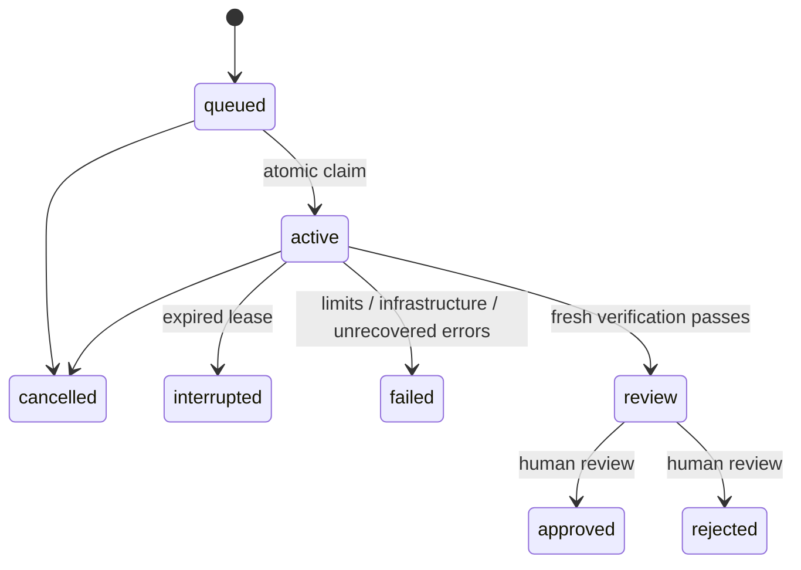

# Architecture, persistence and interfaces

## Decision rationale

The abstract's central problem is the gap between one-shot code output and
repository-level, execution-grounded problem solving. The design therefore treats
model output as typed proposals, source execution as a separate trust domain, test
results as evidence, and final acceptance as an explicit decision. A browser view
makes the evidence inspectable without turning model assertions into success labels.

A single database supplies both task state and an ordered audit trail. PostgreSQL
provides row locks for parallel worker claims; SQLite makes local setup practical.
A separate message broker was not introduced because database-backed claims already
provide the required durable handoff and avoid a dual-write consistency problem.
This choice has a measurable contention ceiling and is not an unlimited-scale claim.

## Runtime components

| Component | Code | Responsibility |
|---|---|---|
| Browser console | `web/` | Runs, project policies, timeline, patch, tests, review, export, readiness |
| Control API | `server/devmind/api.py` | Auth, request constraints, state queries and controlled mutations |
| Contracts/config | `contracts.py`, `config.py` | Typed actions and operator-managed repository/model policy |
| Persistence | `database.py` | Queue, ownership leases, events, artifacts and review transactions |
| Worker | `runner.py` | Planning, context management, tool invocation, iterative correction |
| Model gateway | `model.py` | Bounded inference request, retries, schema decoding, token accounting |
| Execution broker | `isolation.py`, `executor.py` | Resource-limited container and ACI implementation |
| Source operations | `operations.py` | Bounded processes, Git blob ingestion and independent patch synthesis |
| Research utilities | `research.py`, `research/` | Benchmark intake, dataset separation, optional training and metrics |

## State machine

An active run has a phase: preparing, planning, running or verifying. Terminal
labels never pretend to be official benchmark outcomes. Approved does not mean
pushed or merged. An interrupted attempt is not automatically replayed; submit a
new request key to preserve independent attempt history.

## Database schema

`runs`: UUID ID; unique request key; request fingerprint; JSON request; status and
phase; owner token and lease expiry; creation/update times; JSON result and review.

`events`: increasing integer sequence; run foreign key; timestamp; event kind and
JSON payload. The cursor API orders by sequence, not timestamp.

`artifacts`: composite `(run_id, name)` key; SHA-256; text content. Patches are bounded
at 4 MiB. A content-addressed object store is the next storage migration when artifact
volume justifies it; no object-store integration is claimed in the shipped version.

The exact generated PostgreSQL DDL is in `schema.sql`. `devmind init` creates this
initial schema. The baseline is tracked in `schema_version`; unknown versions fail startup. Future changes
require an explicit, reviewed migration and backup/restore test.

## Concurrency and reliability

Submission serializes admission with a PostgreSQL transaction advisory lock, or
SQLite `BEGIN IMMEDIATE`, before checking pending capacity. A unique request key
also resolves concurrent identical submissions. Conflicting request fingerprints
are rejected. Capacity is shared across all submitting API processes using the DB.

PostgreSQL claims use `FOR UPDATE SKIP LOCKED`. SQLite claims use a conditional
update and verify affected-row count. Renewals, event writes and completion require
matching owner, active state and unexpired lease. Cancellation clears ownership.
Artifact insertion, completion state and final event are one transaction. Human
review and its event are also one transaction. PostgreSQL lease timestamps use the
database clock rather than clocks on individual worker hosts.

The worker renews every lease/3 seconds. If renewal fails, it stops authorizing new
actions. If a worker dies, the next polling claim marks expired attempts interrupted.
This does not terminate a container already running; an external supervisor/orphan
cleanup procedure is still needed. Exactly-once tool execution is not asserted.

## Source and execution boundaries

The operator registers a local checkout and trusted image. Git resolves an immutable
commit and reads tracked blobs directly. Dirty files, ignored caches, node_modules,
symlinks and submodules are excluded or rejected explicitly. Archive export rules
cannot hide source because `git archive` is not used.

The worker holds the baseline in memory. It sends validated bytes to a container
without mounting the host checkout. The agent may modify disposable workspace Git
state, but final patch generation uses a new controller-owned Git index. Model
completion cannot choose the baseline or fabricate a patch by altering `.git`.

The Docker helper runs from a read-only image under isolated Python startup.
Containers have no network, no host mounts, no Docker socket and no provider keys.
They use non-root UID 65532, dropped capabilities, no-new-privileges, CPU/memory/PID
limits and bounded writable tmpfs. Shell tool argv still allows arbitrary code
inside that container; the container is the execution boundary, not an argv allowlist.

## Verification semantics

The worker records baseline tests, requires a concise plan, and requires read-before-
edit for existing files through the typed edit tool. On submit it exports a candidate,
generates a patch, rejects protected-path changes or emptiness, and tests the candidate
in a new container. A failed independent test is an observation for another iteration.
A successful test yields review only if lease ownership still holds.

Protected files are not a proof against indirect test evasion. A malicious candidate
could change imports or application behavior to make an inadequate test pass. Use
meaningful operator-owned commands, comprehensive protected config paths and separate
hidden evaluation. Official SWE-bench verification remains external.

## API

All `/api` routes require `Authorization: Bearer TOKEN`. The token represents one
operator role; this is not per-user RBAC. Browser assets and `/health` are public on
the bound address. The default address is loopback only.

| Method and route | Contract |
|---|---|
| `GET /api/system` | Configured model, DB dialect, Docker CLI detection, budgets |
| `GET /api/projects` | Approved repository aliases, image/test/protected policies |
| `GET /api/runs?limit=N` | Latest bounded run list, internal ownership omitted |
| `POST /api/runs` | RunRequest plus Idempotency-Key header; 201 or 200 on replay |
| `GET /api/runs/{id}` | Status, phase, result and review |
| `GET /api/runs/{id}/events?cursor=N` | Up to 200 subsequent ordered events |
| `POST /api/runs/{id}/cancel` | Fence pending/active run; idempotent outcome |
| `POST /api/runs/{id}/review` | Approve/reject only a run awaiting review |
| `GET /api/runs/{id}/patch` | Plain patch and SHA-256 ETag |
| `GET /api/runs/{id}/prediction` | One official-format JSONL prediction for terminal benchmark run |
| `GET /api/runs/{id}/trajectory?consent=true` | Source-bearing training candidate only after human approval |

Body limit is 32 KiB, API request rate is capped per client address per process, and
queue capacity is bounded transactionally. A reverse proxy must enforce connection
and slow-body limits and distributed rate limiting for exposed deployments. The
console polls every 2.5 seconds and never uses `innerHTML` for model/source content.

## Scaling path and cost model

API replicas can share PostgreSQL; independent workers claim jobs using row locks.
Place workers on dedicated execution hosts. Each host must have the registered
project clone and image. Move repository snapshots/artifacts to immutable shared
storage when geographically distributing workers. Use OIDC/RBAC, separate tenant
quotas, stronger sandboxing and scoped credentials before multi-tenant use.

Let λ be arrivals/second and E[S] mean task service time. For target utilization
ρ<1, a starting worker estimate is `ceil(λ E[S]/ρ)`. Little's law yields `L=λW`
for steady-state jobs in system. Neither equation determines p99 latency. Measure
inference latency, container startup, test duration, snapshot costs, DB contention,
queue age and failure rates before selecting capacity/SLOs.

The watchdog fences terminal state and requests cleanup at the run deadline. Current model calls and cleanup can
outlive it. Inference retries can take three 45-second requests plus backoff. Hard
cross-service deadlines require an external job supervisor. Token checks occur
between calls; one response may overshoot. Missing provider token usage uses a
conservative character-count estimate rather than claiming exact tokenization.
